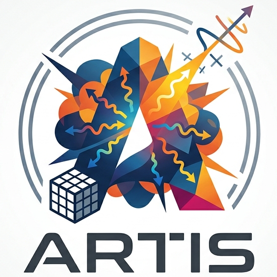

# ARTIS

[](https://doi.org/10.5281/zenodo.7728326)
[](https://github.com/artis-mcrt/artis/actions/workflows/ci.yml)
[](https://artis-mcrt.readthedocs.io/)
[](https://github.com/artis-mcrt/artis/blob/main/LICENSE)



ARTIS is a 3D Monte Carlo radiative transfer code for ejecta in homologous expansion, e.g. supernovae and kilonovae. It follows indivisible energy packets through the ejecta, and it gives the light curves and the spectra. [Lucy (2002), A&A, 384, 725-735, doi:10.1051/0004-6361:20011756](https://ui.adsabs.harvard.edu/abs/2002A%26A...384..725L/abstract) describes the packets. The code runs on an HPC cluster with MPI, and it also runs on a laptop.

## Documentation

The full documentation is at [artis-mcrt.readthedocs.io](https://artis-mcrt.readthedocs.io/). It comes from the [docs](docs) folder of this repository.

- Tutorials:
  - [Quickstart](https://artis-mcrt.readthedocs.io/en/latest/quickstart.html)
  - [Example: a nebular spectrum](https://artis-mcrt.readthedocs.io/en/latest/example.html)
  - [Make your own model](https://artis-mcrt.readthedocs.io/en/latest/ownmodel.html)
- Guides:
  - [Installation](https://artis-mcrt.readthedocs.io/en/latest/installation.html)
  - [Atomic and model data](https://artis-mcrt.readthedocs.io/en/latest/data.html)
  - [Plan a simulation](https://artis-mcrt.readthedocs.io/en/latest/planning.html)
  - [Runs on a cluster](https://artis-mcrt.readthedocs.io/en/latest/clusters.html)
  - [Analyse the results](https://artis-mcrt.readthedocs.io/en/latest/analysis.html)
  - [Troubleshooting](https://artis-mcrt.readthedocs.io/en/latest/troubleshooting.html)
- Concepts:
  - [How a simulation works](https://artis-mcrt.readthedocs.io/en/latest/simulation.html)
  - [Methods and references](https://artis-mcrt.readthedocs.io/en/latest/methods.html)
- Reference:
  - [Option presets](https://artis-mcrt.readthedocs.io/en/latest/presets.html)
  - [Compile-time options](https://artis-mcrt.readthedocs.io/en/latest/options.html)
  - [Input files](https://artis-mcrt.readthedocs.io/en/latest/inputfiles.html)
  - [Output files](https://artis-mcrt.readthedocs.io/en/latest/outputfiles.html)
- Development:
  - [Development setup](https://artis-mcrt.readthedocs.io/en/latest/development.html)
  - [Testing](https://artis-mcrt.readthedocs.io/en/latest/testing.html)

The links above go to the version `latest`, which describes the branch `main`. The version [stable](https://artis-mcrt.readthedocs.io/en/stable/) describes the newest release tag, and the branch `release` holds the same code ([Runs on a cluster](https://artis-mcrt.readthedocs.io/en/latest/clusters.html#which-version-to-use) says which one to use).

## Quickstart

```sh
git clone https://github.com/artis-mcrt/artis.git
cd artis
tests/runtest.sh kilonova_1d
```

This builds the code and runs a small 1D kilonova model in two jobs, and then post-processes the packets with `exspec`. The script compares the checksums of the output files with the stored checksums. A different compiler or CPU type can give different checksums. At the end, the script then lists the files that differ. The [Quickstart](https://artis-mcrt.readthedocs.io/en/latest/quickstart.html) page describes the steps and makes a model folder of your own. [Installation](https://artis-mcrt.readthedocs.io/en/latest/installation.html) lists the compiler, the MPI library, and the commands that the test needs.

## Key features

[Key features](https://artis-mcrt.readthedocs.io/en/latest/#key-features) on the documentation site describes the geometry, the physics, and the parallel runs, with the references.

## Citing ARTIS

If you use ARTIS, please cite it with the Zenodo DOI [10.5281/zenodo.7728326](https://doi.org/10.5281/zenodo.7728326). This DOI always resolves to the newest version. [Citing ARTIS](https://artis-mcrt.readthedocs.io/en/latest/#citing-artis) lists the paper of each feature, and we maintain a list of [papers that use ARTIS](https://ui.adsabs.harvard.edu/user/libraries/g5NyA9gKT5KdDFLY6SixWg).

An early version of the code is described in [Sim (2007), MNRAS, 375, 154-162, doi:10.1111/j.1365-2966.2006.11271.x](https://ui.adsabs.harvard.edu/abs/2007MNRAS.375..154S/abstract) and [Kromer & Sim (2009), MNRAS, 398, 1809-1826, doi:10.1111/j.1365-2966.2009.15256.x](https://ui.adsabs.harvard.edu/abs/2009MNRAS.398.1809K/abstract).

## Source code availability and license

The ARTIS source code is available under a [BSD 3-Clause license](https://github.com/artis-mcrt/artis/blob/main/LICENSE), which requires attribution and preservation of copyright notices on any substantial copies. If you find the ARTIS code useful in any way, we request that you cite us as described above and star the repository to help show impact in funding proposals.

## Support

No one is employed specifically to maintain ARTIS. The developers improve the code when their own research needs it. Thus ARTIS comes as it is, and the developers do not promise to correct a defect or to answer a question. They accept a pull request sometimes. [CONTRIBUTING.md](CONTRIBUTING.md) gives the steps of a change.
